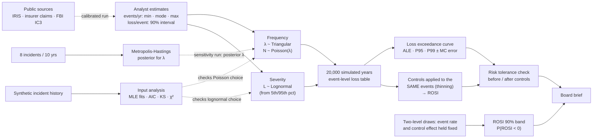

# Cyber Risk Quantification with Monte Carlo Simulation

**FAIR-style annual loss modeling in R: turn analyst estimates into a loss exceedance curve, price security controls by return on investment, and update incident rates with Bayesian MCMC.**

[](https://github.com/casildata/cyber-risk-monte-carlo/actions/workflows/pipeline.yml)


> **Origin:** built on simulation methods from my graduate work in **Simulation & Optimization** at Texas Tech University (2022): input distributions, distribution fitting, Monte Carlo risk analysis, bootstrapping and Metropolis-Hastings. The original studies applied them to travel times, a drug launch and a newsvendor; this repository applies them to cyber risk.

---

## TL;DR

The question a CISO gets from the board: *"How much could we lose to cyber incidents next year, and is this control worth buying?"*

| Output | Result (illustrative inputs, 20,000 simulated years) |
|---|---|
| **Annualized loss expectancy** (5 scenarios) | **$1.20M** ± $11k mean, $0.68M median: the mean is pulled up by rare, large events |
| **1-in-20-year loss** (P95) | **$4.03M** ± $60k · 1-in-100-year: $7.58M ± $160k |
| **P(annual loss > $5M)** | **3.0%** |
| **Risk tolerance** | Outside an illustrative appetite for annual losses of about $1.5M–$8.7M: P(loss > $2.5M) is **12.2%** against 10% tolerated. The three controls bring the curve back inside. |
| **Best control by ROSI** | Phishing-resistant MFA + payment call-back: **+184%** expected, **1.4%** chance it loses money |
| **Ransomware control** | EDR + immutable backups: **+69%** expected, but a **14%** chance it loses money, almost entirely because ransomware frequency is uncertain. Perfect information would be worth only about **$4k a year** (3% of its cost), so buy it rather than wait for better estimates. It pays back in only 17% of years, because its value is the rare bad year. |
| **Bayesian rate check** | Corrected Metropolis-Hastings matches the exact posterior mean (0.899, split R̂ 1.000); the original 2022 sampler was biased (0.934), almost entirely from a missing Hastings correction. Fed into the simulation, the posterior says insider misuse is 1.9 times as frequent as the analyst's estimate |
| **Calibrated inputs** | Re-sized from Cyentia IRIS 2025, insurer claims data and FBI IC3 for a $500M critical-infrastructure operator: expected loss **$503k** a year instead of $1.20M, but a heavier far tail (P(loss > $20M) **0.21%** against 0.1% tolerated). The three controls together pull that tail back inside tolerance, but on expected value only EDR comes close to paying for itself (−1%); MFA and DLP return −73% |

± is one Monte Carlo standard error (bootstrap over simulated years): how far another random seed could move the figure. It says nothing about whether the inputs are right.

**One-page summary for a board or CFO:** [`docs/board-brief.md`](docs/board-brief.md), generated with the rest of the results.


> **Data note:** the headline results use **illustrative assumptions for a hypothetical mid-size company** ([`data/assumptions/`](data/assumptions/)), not benchmarks. A second scenario file sizes three of the five scenarios from cited public sources ([`docs/calibration.md`](docs/calibration.md)); control costs and the risk tolerance stay illustrative in both. The "historical" records used for input analysis are synthetic.

---

## Approach



Solid arrows are the simulation. Dashed arrows are checks: input analysis tests whether the distribution families are reasonable, and the MCMC posterior replaces the insider-misuse estimate in a separate run, while the headline results keep the analyst's estimate.

| Step | Script | Technique |
|---|---|---|
| 1. Input analysis | [`01_input_analysis.R`](scripts/01_input_analysis.R) | Fit Poisson vs. negative binomial to monthly counts (AIC, χ² goodness of fit, dispersion); fit lognormal, gamma, Weibull and exponential to past losses (MLE, AIC, Kolmogorov-Smirnov, Q-Q plot) |
| 2. Annual loss | [`02_simulate_annual_loss.R`](scripts/02_simulate_annual_loss.R) | Input validation; compound Poisson-lognormal per scenario with uncertain frequency; loss exceedance curve; ALE, P90/P95/P99 with bootstrap Monte Carlo standard errors; sensitivity to the frequency distribution, a loss cap and double-extortion dependence |
| 3. Control ROI | [`03_control_roi.R`](scripts/03_control_roi.R) | Controls thin the same simulated events (common random numbers) and compound when several act on one scenario; expected ROSI; two-level uncertainty for a 90% band and P(ROSI < 0); expected value of perfect information; severity uncertainty |
| 4. Bayesian rate | [`04_bayesian_frequency.R`](scripts/04_bayesian_frequency.R) | Random-walk Metropolis-Hastings on log λ, burn-in, acceptance rate, effective sample size, split R̂ and MCSE, validated against the exact Gamma posterior; each bug in the original sampler isolated over 10 chains; posterior fed back into the simulation |
| 5. Risk tolerance | [`05_risk_tolerance.R`](scripts/05_risk_tolerance.R) | Loss exceedance curve vs. a tolerance curve on log-probability scales, before and after the controls |
| 6. Calibrated inputs | [`06_calibrated_inputs.R`](scripts/06_calibrated_inputs.R) | The same model on inputs sized from public sources, size-adjusted with IRIS revenue-tier statistics; both loss exceedance curves against the tolerance; control ROSI under sourced inputs |
| 7. Board brief | [`07_board_brief.R`](scripts/07_board_brief.R) | One-page summary built from the tables above |

The model itself (event simulation, controls, two-level draws) is in [`R/model.R`](R/model.R) and the samplers in [`R/mcmc.R`](R/mcmc.R), both covered by unit tests.

Full tables and all figures: [`docs/results.md`](docs/results.md).

## Results

### Annual loss by scenario

| Scenario | ALE (mean) | Median | P95 (1-in-20) | P(any loss in a year) |
|---|---|---|---|---|
| Ransomware | $338k | $0 | $2.15M | 18% |
| Business email compromise | $239k | $137k | $827k | 83% |
| Customer data breach | $381k | $0 | $2.00M | 33% |
| DDoS outage | $132k | $90.5k | $401k | 90% |
| Insider misuse | $114k | $0 | $592k | 36% |
| **Total** | **$1.20M** ± $11k | **$679k** | **$4.03M** ± $60k | 99% |

Rounded to three significant figures, which is more than the Monte Carlo error supports for the tails. Exact values and standard errors for every scenario are in [`docs/results.md`](docs/results.md).


Ransomware has a median of $0 yet the highest 1-in-20 loss. Ranking risks by "how often" or by the average alone would hide that.

**Sensitivity.** The same seed, one modeling choice changed at a time:

| Model | Total ALE | P95 (1-in-20) | P99 (1-in-100) | Largest single event |
|---|---|---|---|---|
| Base: triangular frequency, uncapped | $1.20M | $4.03M | $7.58M | $31.2M |
| Beta-PERT frequency | $1.05M | $3.72M | $7.23M | $26.4M |
| Single loss capped at $10M | $1.19M | $4.03M | $7.58M | $10.0M |
| Double extortion: 30% of ransomware events also leak data | $1.20M | $4.18M | $7.79M | $31.2M |

- **Beta-PERT** (the usual FAIR choice) puts less weight near the extremes of the min / mode / max estimate. Every mode here sits below the midpoint of its range, so PERT lowers the expected event rate and the ALE drops 13%. The choice of distribution moves results more than the Monte Carlo error does.
- **A $10M cap barely matters up to the 1-in-100 year.** Uncapped, one simulated event costs $31.2M, implausible for a mid-size company. But P95 and P99 sit below $10M, so capping single losses there can't move them; it trims the ALE by about 1% and shortens only the extreme tail. A cap near the P95 would matter. Either choice can be set per scenario with the optional `lef_dist` and `loss_cap` columns.
- **Dependence is modeled directly, not with a copula.** In the double-extortion run, each ransomware event also causes a data-breach loss with probability 0.3, and the standalone breach rate is lowered by the same expected number of events. Breach frequency is unchanged on average (breach ALE $381k vs. $376k), so only the timing changes: large breach losses now arrive in ransomware years. The 1-in-20 loss rises from $4.03M to $4.18M and the 1-in-100 from $7.58M to $7.79M.

### Control return on security investment

| Control | Annual cost | Loss avoided / yr (90% uncertainty band) | ROSI (90% band) | P(ROSI < 0) | Years it pays back |
|---|---|---|---|---|---|
| EDR + immutable backups | $150k | $253k ($115k – $429k) | +69% (−23% to +186%) | about 14% | 17% |
| Phishing-resistant MFA + payment call-back | $60k | $171k ($75.8k – $289k) | +184% (+26% to +382%) | 1.4% | 56% |
| DLP + database encryption | $120k | $205k ($91.0k – $356k) | +70% (−24% to +197%) | about 14% | 27% |

**Why thinning?** Each control is applied to the *same* simulated events: an event is prevented with probability *r<sub>f</sub>*, which gives exactly a Poisson process at rate λ(1 − *r<sub>f</sub>*). Comparing "with" and "without" on identical draws removes most of the simulation noise from the difference.

**Two kinds of uncertainty.** The simulation redraws the event rate and the control's effectiveness every year, which is right for "what could next year look like?" and gives the expected ROSI. It is wrong for "how sure are we this control pays off?", because what we don't know about a control doesn't change from year to year. So script 03 also runs a two-level analysis: draw the long-run event rate and the control's effectiveness once, hold them fixed, and compute the expected loss avoided in closed form (10,000 draws). That gives the 90% bands and **P(ROSI < 0)**, the chance that the control costs more than it saves on average.


- **MFA is the safe bet:** even at the 5th percentile it returns +26%.
- **EDR and DLP pay off on average, but each has about a 1-in-7 chance of losing money.**
- **Not knowing the event rate drives all of that risk.** With the rate fixed at its expected value, no control loses money even at the bottom of its effectiveness range. A better frequency estimate is worth more here than a better effectiveness estimate.

**Is it worth learning more before buying?** The expected value of perfect information (EVPI) is the most it would be worth paying, per year, to know the true inputs before deciding. The *wider losses* columns add uncertainty about loss size: each scenario's 90% loss interval is widened by a factor of 1.5 in the outer draws (a lognormal multiplier with mean 1), which the optional `loss_uncertainty` column sets per scenario.

| Control | P(ROSI < 0) | EVPI / yr | P(ROSI < 0), wider losses | ROSI 90% band, wider losses | EVPI / yr, wider losses |
|---|---|---|---|---|---|
| EDR + immutable backups | about 14% | $4.0k | about 19% | −31% to +218% | $6.2k |
| Phishing-resistant MFA + payment call-back | 1.4% | $98 | 3.3% | +11% to +429% | $320 |
| DLP + database encryption | about 14% | $3.4k | about 18% | −34% to +223% | $5.2k |

- **A 1-in-7 chance of losing money doesn't mean "wait".** Even for EDR, resolving every uncertainty would be worth at most about $4k a year, 3% of what the control costs, so a better estimate would rarely change the decision.
- **Uncertain loss sizes widen the bands but don't move the expected ROSI.** EDR's chance of losing money goes from about 14% to about 19%.

The Monte Carlo 95% CI for each mean, which measures only simulation noise, is in [`docs/results.md`](docs/results.md).

### Risk tolerance

[`data/assumptions/tolerance.csv`](data/assumptions/tolerance.csv) holds an illustrative risk appetite, the form a board's tolerance statement takes in Hubbard & Seiersen's method: "no more than a 10% chance of losing over $2.5M in a year", and so on. Script 05 checks the loss exceedance curve against it, before and after the three controls:

| Annual loss over | Tolerated | Today | With the three controls |
|---|---|---|---|
| $1M | 50% | 36.9% | 15.7% |
| $2.5M | 10% | **12.2%** | 2.9% |
| $5M | 2% | **3.0%** | 0.4% |
| $10M | 0.5% | 0.41% | 0.03% |
| $20M | 0.1% | 0.03% | 0.00% |

The figure at the top of this page plots this table on log-probability scales.

Today's curve is above tolerance for annual losses between about $1.5M and $8.7M: the middle of the tail, not the extreme end. The upper end rests on few simulated years and moves between about $8.4M and $9.4M with the seed. With the three controls it is inside everywhere. On log-probability scales the far tail is visibly a staircase: below about 0.05%, each step is one or two simulated years.

### Calibrated inputs

[`scenarios_calibrated.csv`](data/assumptions/scenarios_calibrated.csv) re-sizes the scenarios for one profile, a mid-size US critical-infrastructure operator (about $500M revenue), from public sources: Cyentia IRIS 2025 for incident likelihood and losses, Coalition's cyber insurance claims for frequency at $100M+ revenue, and FBI IC3 2025 for business email compromise losses. IRIS's revenue-tier statistics scale the all-size loss figures down to this tier (median ×0.77, log-spread ×0.82). Every row names its sources and a confidence level; [`docs/calibration.md`](docs/calibration.md) shows the arithmetic. DDoS and insider misuse have no usable public figures at this size and keep their illustrative values.

| Scenario | Confidence | ALE, illustrative | ALE, calibrated | P95, illustrative | P95, calibrated |
|---|---|---|---|---|---|
| Ransomware | medium | $338k | $175k | $2.15M | $0 |
| Business email compromise | low | $239k | $24.4k | $827k | $139k |
| Customer data breach | low | $381k | $56.2k | $2.00M | $0 |
| DDoS outage | not calibrated | $132k | $132k | $401k | $402k |
| Insider misuse | not calibrated | $114k | $114k | $592k | $579k |
| **Total** | | **$1.20M** | **$503k** | **$4.03M** | **$1.42M** |


- **The analyst's estimates were too frequent and too thin-tailed.** Sourced frequencies are far lower (ransomware about 0.03 events a year instead of 0.2; wire fraud 0.19 instead of 2), so a typical year costs less. But IRIS's ransomware losses run to a $24M 95th percentile per event, so the curves cross near $9M and the calibrated tail is heavier: P(loss > $20M) is 0.21% ± 0.03 against 0.1% tolerated. At $10M (0.54% ± 0.05 against 0.5%) the breach is within noise.
- **The control decision changes.** Under sourced inputs, EDR + immutable backups returns −1% on average (56% chance it loses money), and MFA and DLP return −73% with no draw paying back. The three together still bring the calibrated tail back inside tolerance (P(loss > $20M) 0.03%). A control that breaks even on average but removes the tail the board said it won't accept is the case for optimizing against tail risk, not the mean.
- **A ransomware P95 of $0 is not a bug:** with about 0.03 events a year, fewer than 5% of simulated years have one.
- **About half of the calibrated expected loss sits in the two uncalibrated rows**, so the calibrated total is only as good as those illustrative values.

### Validating the MCMC sampler

| Method | Posterior mean | 95% interval |
|---|---|---|
| Exact Gamma(9, 10.01) | 0.899 | 0.411 – 1.575 |
| **Corrected** Metropolis-Hastings | 0.899 | 0.407 – 1.602 |
| Original 2022 version | 0.934 | 0.390 – 1.678 |

The original 2022 sampler had two bugs: it stored only *accepted* proposals, and it drew proposals from a normal truncated at 0 without the Hastings correction that an asymmetric proposal needs. One chain can't tell a bias of a few hundredths from noise, so script 04 runs each bug on its own, 10 chains of 20,000 iterations each, first 1,000 dropped:

| Sampler | Posterior mean | Chain-to-chain sd | Bias vs. exact 0.899 |
|---|---|---|---|
| Corrected: log random walk, every iteration | 0.902 | 0.003 | +0.003 |
| Bug 1 only: accepted proposals only | 0.893 | 0.002 | −0.006 |
| Bug 2 only: truncated proposal, no Hastings correction | 0.928 | 0.005 | **+0.029** |
| Truncated proposal *with* Hastings correction | 0.900 | 0.005 | +0.000 |
| Both bugs (original) | 0.931 | 0.005 | **+0.032** |

- **The missing Hastings correction causes almost all of the bias.** Near zero, truncation pushes proposals upward, and without the correction nothing offsets that, so the chain drifts high.
- **The truncated proposal itself was fine.** With the correction it is unbiased. Switching to a log-scale random walk is a cleaner fix, not the only one.
- **Storing only accepted proposals is still wrong, but smaller here,** and it pulls the other way. Rejections repeat the current state, and dropping them under-weights the states where the chain lingers.

**Convergence.** Split R̂ over four chains started at 0.05, 0.5, 2 and 5 is 1.000, and the Monte Carlo standard error of the posterior mean is 0.005.

**From posterior to loss.** Script 04 then replaces the analyst's insider-misuse estimate (0.1 / 0.3 / 1.0 events a year, mean 0.47) with draws from the posterior (mean 0.90) and simulates again with the same seed:

| Insider-misuse frequency | Insider-misuse ALE | Insider-misuse P95 | Total ALE | Total P99 |
|---|---|---|---|---|
| Analyst's estimate | $114k | $592k | $1.20M | $7.58M |
| MCMC posterior (8 incidents in 10 years) | $219k | $945k | $1.31M | $7.64M |

The evidence nearly doubles this scenario's expected loss but barely moves the total tail, which ransomware and breaches drive. The headline results keep the analyst's estimate because the eight incidents are part of an illustrative story; with real incident logs, this is where evidence replaces a guess.

## Framework mapping

### FAIR

The model follows the [FAIR](https://www.fairinstitute.org/) structure at its top level, with two simplifications:

| FAIR term | In this repo | Simplification |
|---|---|---|
| Loss Event Frequency (LEF) | `lef_min` / `lef_mode` / `lef_max` → triangular λ, then Poisson event counts | Estimated directly, not built up from Threat Event Frequency × Vulnerability |
| Loss Magnitude (LM) | `loss_p05` / `loss_p95` → lognormal loss per event | One distribution per event, with no primary/secondary loss split |
| Annualized loss exposure | Mean simulated annual loss (ALE) | |
| Loss exceedance curve | P(annual loss > x) over 20,000 simulated years | Scenarios are independent in the base run; double extortion (ransomware that also leaks data) is a sensitivity run |
| Control effect | `freq_red_*` reduces LEF by thinning, `sev_red_*` reduces LM | Each control acts on one scenario; several controls on the same scenario compound per event, with no other interactions |

### NIST CSF 2.0

| Outcome | How this repo supports it |
|---|---|
| **GV.RM-02** Risk appetite and risk tolerance statements are established, communicated, and maintained | `tolerance.csv` states the appetite as a curve, and script 05 tests the loss exceedance curve against it before and after controls |
| **GV.RM-06** A standardized method for calculating, documenting, categorizing, and prioritizing cybersecurity risks is established and communicated | One method, frequency × magnitude in dollars, is applied to every scenario |
| **ID.RA-04** Potential impacts and likelihoods of threats exploiting vulnerabilities are identified and recorded | `scenarios.csv` records a likelihood range and a 90% impact interval per scenario |
| **ID.RA-05** Threats, vulnerabilities, likelihoods, and impacts are used to understand inherent risk and inform risk response prioritization | ALE and P95 per scenario, before controls |
| **ID.RA-06** Risk responses are chosen, prioritized, planned, tracked, and communicated | ROSI, P(ROSI < 0) and residual risk for each candidate control, summarized in the board brief |

### Scenarios, ATT&CK and CIS Controls v8.1

Tags are for orientation. They are my mapping, not an official crosswalk. Every mitigation listed is one MITRE maps to at least one of the techniques in its row.

| Scenario | MITRE ATT&CK techniques | Control modeled | CIS v8.1 safeguards | ATT&CK mitigations |
|---|---|---|---|---|
| Ransomware | T1486 Data Encrypted for Impact, T1490 Inhibit System Recovery | EDR + immutable backups | 10.1, 10.7 (anti-malware, behavior-based); 11.2, 11.3, 11.4 (backups, protected and isolated recovery data) | M1040 Behavior Prevention on Endpoint, M1053 Data Backup |
| Business email compromise | T1566 Phishing, T1078 Valid Accounts, T1114 Email Collection | Phishing-resistant MFA + payment call-back | 6.3, 6.5 (MFA); 14.2 (social-engineering training). The call-back is a finance process control with no CIS safeguard. | M1032 Multi-factor Authentication, M1017 User Training |
| Customer data breach | T1213 Data from Information Repositories (databases), then T1567 Exfiltration Over Web Service or T1041 Exfiltration Over C2 Channel | DLP + database encryption | 3.13 (DLP), 3.11 (encrypt data at rest) | M1057 Data Loss Prevention, M1041 Encrypt Sensitive Information |
| DDoS outage | T1498 Network Denial of Service, T1499 Endpoint Denial of Service | None modeled | No CIS v8.1 safeguard mentions denial of service; 13.10 (application-layer filtering) covers part of the application-layer case | M1037 Filter Network Traffic |
| Insider misuse | ATT&CK describes techniques, not intent, so misuse of legitimate access maps at best to T1078 Valid Accounts. MITRE's Center for Threat-Informed Defense keeps a separate [Insider Threat TTP Knowledge Base](https://ctid.mitre.org/projects/insider-threat-ttp-knowledge-base). | None modeled | 6.8 (role-based access control), 3.14 (log sensitive data access) | M1026 Privileged Account Management, M1018 User Account Management |

## Getting started

### Requirements

- R 4.4 or later (tested on 4.6.1) with `ggplot2`, `scales` and `patchwork` (`MASS` ships with R), plus `testthat` for the tests.
- No external data: the inputs are in `data/assumptions/`.

### Install

Nothing is installed automatically: if a package listed in [`r-packages.txt`](r-packages.txt) is missing, the run stops and prints the install command. To install the current CRAN versions:

```r
install.packages(c("ggplot2", "scales", "patchwork", "testthat"))
```

To install the exact package versions this was tested with, from [`renv.lock`](renv.lock):

```r
install.packages("renv")
renv::restore()
```

### Run

```bash
Rscript run_all.R
Rscript -e 'testthat::test_dir("tests/testthat")'   # unit tests
```

To model your own organization, edit `scenarios.csv`, `controls.csv` and `tolerance.csv` in `data/assumptions/`, then re-run. Columns are described in [`data/README.md`](data/README.md).

### Output

About 25 seconds. Edits to the assumption files are validated first: a typo such as `lef_mode` outside `lef_min`–`lef_max`, a reduction above 100%, a control pointing at a missing scenario or a repeated control name stops the run with a message that names the row. The report goes to `docs/results.md`, the board brief to `docs/board-brief.md` and the figures to `docs/figures/`; intermediate tables go to `outputs/` (git-ignored).

`outputs/annual_loss_by_year.csv.gz` holds the loss for every simulated year and scenario, for downstream use such as optimizing a control budget against the tail rather than the mean. The same file is attached to the [v1.0 release](https://github.com/casildata/cyber-risk-monte-carlo/releases/tag/v1.0). `outputs/annual_loss_calibrated_by_year.csv.gz` is the same table for the calibrated inputs, attached to the [v1.1 release](https://github.com/casildata/cyber-risk-monte-carlo/releases/tag/v1.1).

**Related:** [security-budget-optimizer](https://github.com/casildata/security-budget-optimizer) takes the scenario ALEs from this release and picks the control portfolio that removes the most expected loss under a budget, compliance mandates and analyst capacity.

### Tests and CI

The unit tests check the samplers against their closed forms (triangular and PERT means, simulated ALE vs. the exact compound-Poisson mean, the capped-lognormal mean, the two-level average, with and without severity uncertainty), the control logic (a control that does nothing avoids nothing; a perfect one avoids everything; two controls on one scenario compound instead of adding up; trailing years without events are kept), EVPI, double extortion keeping the breach frequency, input validation, the MCMC samplers and split R̂. [GitHub Actions](.github/workflows/pipeline.yml) runs the tests and the full pipeline on every push, fails if any number in `docs/results.md` or `docs/board-brief.md` changes, and scans the history for secrets with gitleaks.

## Repository structure

```
cyber-risk-monte-carlo/
├── run_all.R                    # runs scripts 01-06, writes docs/results.md
├── r-packages.txt               # R packages the scripts need
├── renv.lock                    # exact package versions
├── R/
│   ├── check_packages.R         # stops with install instructions if a package is missing
│   ├── distributions.R          # triangular and PERT samplers, lognormal-from-interval, dollar formats
│   ├── model.R                  # event simulation, controls, two-level draws, exceedance
│   ├── mcmc.R                   # Metropolis-Hastings samplers
│   ├── report.R                 # markdown report + figure helpers
│   └── validate.R               # checks on the assumption files
├── scripts/01_…07_*.R
├── tests/testthat/              # unit tests
├── data/
│   ├── assumptions/             # scenarios.csv, controls.csv, tolerance.csv (edit these),
│   │                            # scenarios_calibrated.csv (sourced inputs)
│   └── README.md
├── docs/
│   ├── results.md               # generated
│   ├── board-brief.md           # generated
│   ├── calibration.md           # sources and arithmetic for the calibrated inputs
│   └── figures/                 # generated
└── .github/workflows/           # tests, results check, secret scan
```

## Skills demonstrated

`Cyber risk quantification (FAIR concepts: loss event frequency, loss magnitude, ALE, loss exceedance)` · `Monte Carlo simulation` · `distribution fitting and goodness-of-fit testing` · `variance reduction with common random numbers` · `bootstrap confidence intervals` · `two-level (epistemic vs. aleatory) uncertainty` · `risk tolerance curves` · `Bayesian inference with MCMC and sampler validation` · `Monte Carlo error estimation` · `unit testing and CI for analytical code` · `NIST CSF 2.0, MITRE ATT&CK and CIS Controls mapping` · `communicating risk in financial terms`

## Roadmap

- Calibrate DDoS and insider misuse, and the control costs and effectiveness, against public sources as well.
- Optimize the control budget against the tail (e.g. CVaR) using the year-by-year losses in the v1.0 and v1.1 releases.
- Split loss event frequency into threat event frequency × vulnerability, and loss into primary and secondary, so controls read in FAIR-CAM terms.
- Shiny front end so a non-technical user can edit assumptions and see the curve update.

## Data & citations

- Freund, J. & Jones, J. (2014). *Measuring and Managing Information Risk: A FAIR Approach.* Butterworth-Heinemann.
- Hubbard, D. & Seiersen, R. (2016). *How to Measure Anything in Cybersecurity Risk.* Wiley.
- NIST IR 8286A (2021). *Identifying and Estimating Cybersecurity Risk for Enterprise Risk Management.*

Calibrated inputs (details and links in [`docs/calibration.md`](docs/calibration.md)):

- Cyentia Institute (2025). *Information Risk Insights Study (IRIS) 2025: It's About Time.*
- Coalition (2025). *2025 Cyber Claims Report*, and the *2026 Cyber Claims Report* announcement.
- FBI Internet Crime Complaint Center (2026). *2025 IC3 Annual Report.*
- Association for Financial Professionals (2025). *2025 Payments Fraud and Control Survey.*
- Sophos (2026). *The State of Ransomware*; IBM (2025). *Cost of a Data Breach Report* (cross-checks only).

## Author

Javier Casildo

## License

MIT. See [LICENSE](LICENSE).
