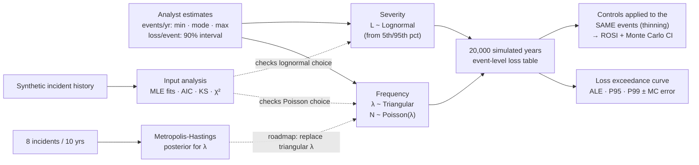

# Cyber Risk Quantification with Monte Carlo Simulation

**FAIR-style annual loss modeling in R: turn analyst estimates into a loss exceedance curve, price security controls by return on investment, and update incident rates with Bayesian MCMC.**


> **Origin:** built on simulation methods from **ISQS 7339 Simulation & Optimization** at Texas Tech University (Spring 2022): input distributions, distribution fitting, Monte Carlo risk analysis, bootstrapping and Metropolis-Hastings. The coursework applied them to travel times, a drug launch and a newsvendor; this repository applies them to cyber risk.

---

## TL;DR

The question a CISO gets from the board: *"How much could we lose to cyber incidents next year, and is this control worth buying?"*

| Output | Result (illustrative inputs, 20,000 simulated years) |
|---|---|
| **Annualized loss expectancy** (5 scenarios) | **$1.20M** ± $11k mean, $0.68M median: the mean is pulled up by rare, large events |
| **1-in-20-year loss** (P95) | **$4.03M** ± $60k · 1-in-100-year: $7.58M ± $160k |
| **P(annual loss > $5M)** | **3.0%** |
| **Best control by ROSI** | Phishing-resistant MFA + payment call-back: **+184%**, pays back in 56% of years |
| **Ransomware control** | EDR + immutable backups: **+69%** ROSI, yet pays back in only 17% of years, because its value is the rare bad year |
| **Bayesian rate check** | Corrected Metropolis-Hastings matches the exact posterior mean (0.899); the original coursework sampler was biased (0.934), almost entirely from a missing Hastings correction |

± is one Monte Carlo standard error (bootstrap over simulated years): how far another random seed could move the figure. It says nothing about whether the inputs are right.


> **Data note:** the scenario and control inputs in [`data/assumptions/`](data/assumptions/) are **illustrative assumptions for a hypothetical mid-size company**, not benchmarks. The "historical" records used for input analysis are synthetic. The method is the deliverable.

---

## Approach



Solid arrows are the simulation. Dashed arrows are checks: input analysis tests whether the distribution families are reasonable, and the MCMC posterior does not yet feed the simulation (see [Roadmap](#roadmap)).

| Step | Script | Technique |
|---|---|---|
| 1. Input analysis | [`01_input_analysis.R`](scripts/01_input_analysis.R) | Fit Poisson vs. negative binomial to monthly counts (AIC, χ² goodness of fit, dispersion); fit lognormal, gamma, Weibull and exponential to past losses (MLE, AIC, Kolmogorov-Smirnov, Q-Q plot) |
| 2. Annual loss | [`02_simulate_annual_loss.R`](scripts/02_simulate_annual_loss.R) | Input validation; compound Poisson-lognormal per scenario with uncertain frequency; loss exceedance curve; ALE, P90/P95/P99 with bootstrap Monte Carlo standard errors |
| 3. Control ROI | [`03_control_roi.R`](scripts/03_control_roi.R) | Controls thin the same simulated events (common random numbers), uncertain frequency/severity reductions, ROSI, Monte Carlo CI for loss avoided |
| 4. Bayesian rate | [`04_bayesian_frequency.R`](scripts/04_bayesian_frequency.R) | Random-walk Metropolis-Hastings on log λ, burn-in, acceptance rate, effective sample size, validated against the exact Gamma posterior; each coursework bug isolated over 10 chains |

Full tables and all figures: [`docs/results.md`](docs/results.md).

## Results

### Annual loss by scenario

| Scenario | ALE (mean) | Median | P95 (1-in-20) | P(any loss in a year) |
|---|---|---|---|---|
| Ransomware | $338k | $0 | $2.15M | 18% |
| Business email compromise | $239k | $137k | $827k | 83% |
| Customer data breach | $381k | $0 | $2.00M | 33% |
| DDoS outage | $132k | $90.5k | $401k | 90% |
| Insider misuse | $114k | $0 | $592k | 36% |
| **Total** | **$1.20M** ± $11k | **$679k** | **$4.03M** ± $60k | 99% |

Rounded to three significant figures, which is more than the Monte Carlo error supports for the tails. Exact values and standard errors for every scenario are in [`docs/results.md`](docs/results.md).

Ransomware has a median of $0 yet the highest 1-in-20 loss. Ranking risks by "how often" or by the average alone would hide that.

### Control return on security investment

| Control | Annual cost | Loss avoided / yr (Monte Carlo 95% CI) | ROSI | Years it pays back |
|---|---|---|---|---|
| EDR + immutable backups | $150k | $253k ($241k – $265k) | +69% | 17% |
| Phishing-resistant MFA + payment call-back | $60k | $171k ($167k – $174k) | +184% | 56% |
| DLP + database encryption | $120k | $205k ($196k – $212k) | +70% | 27% |

**Why thinning?** Each control is applied to the *same* simulated events: an event is prevented with probability *r<sub>f</sub>*, which gives exactly a Poisson process at rate λ(1 − *r<sub>f</sub>*). Comparing "with" and "without" on identical draws removes most of the simulation noise from the difference.

**What the interval means.** It is a bootstrap over simulated years, so it measures Monte Carlo noise in the mean: how far another seed would move it. It is **not** uncertainty about how well the control works. Effectiveness is redrawn from its triangular range every simulated year, so that uncertainty is averaged into the mean rather than widening the interval. If EDR's true effect sat at the bottom of its range every year, the loss avoided would be well outside this interval. *Years it pays back* is the better guide to how variable the payoff is.

### Validating the MCMC sampler

| Method | Posterior mean | 95% interval |
|---|---|---|
| Exact Gamma(9, 10.01) | 0.899 | 0.411 – 1.575 |
| **Corrected** Metropolis-Hastings | 0.899 | 0.407 – 1.602 |
| Original coursework version | 0.934 | 0.390 – 1.678 |

The coursework sampler had two bugs: it stored only *accepted* proposals, and it drew proposals from a normal truncated at 0 without the Hastings correction that an asymmetric proposal needs. One chain can't tell a bias of a few hundredths from noise, so script 04 runs each bug on its own, 10 chains of 20,000 iterations each, first 1,000 dropped:

| Sampler | Posterior mean | Chain-to-chain sd | Bias vs. exact 0.899 |
|---|---|---|---|
| Corrected: log random walk, every iteration | 0.902 | 0.003 | +0.003 |
| Bug 1 only: accepted proposals only | 0.893 | 0.002 | −0.006 |
| Bug 2 only: truncated proposal, no Hastings correction | 0.928 | 0.005 | **+0.029** |
| Truncated proposal *with* Hastings correction | 0.900 | 0.005 | +0.000 |
| Both bugs (original) | 0.931 | 0.005 | **+0.032** |

- **The missing Hastings correction causes almost all of the bias.** Near zero, truncation pushes proposals upward, and without the correction nothing offsets that, so the chain drifts high.
- **The truncated proposal itself was fine.** With the correction it is unbiased. Switching to a log-scale random walk is a cleaner fix, not the only one.
- **Storing only accepted proposals is still wrong, but smaller here,** and it pulls the other way. Rejections repeat the current state, and dropping them under-weights the states where the chain lingers.

## Framework mapping

### FAIR

The model follows the [FAIR](https://www.fairinstitute.org/) structure at its top level, with two simplifications:

| FAIR term | In this repo | Simplification |
|---|---|---|
| Loss Event Frequency (LEF) | `lef_min` / `lef_mode` / `lef_max` → triangular λ, then Poisson event counts | Estimated directly, not built up from Threat Event Frequency × Vulnerability |
| Loss Magnitude (LM) | `loss_p05` / `loss_p95` → lognormal loss per event | One distribution per event, with no primary/secondary loss split |
| Annualized loss exposure | Mean simulated annual loss (ALE) | |
| Loss exceedance curve | P(annual loss > x) over 20,000 simulated years | Scenarios are independent; a copula is on the roadmap |
| Control effect | `freq_red_*` reduces LEF by thinning, `sev_red_*` reduces LM | Each control acts on one scenario; no control interactions |

### NIST CSF 2.0

| Outcome | How this repo supports it |
|---|---|
| **GV.RM-02** Risk appetite and risk tolerance statements are established | The loss exceedance curve is where a tolerance statement ("no more than a 5% chance of losing over $4M in a year") is tested |
| **GV.RM-06** A standardized method for calculating and prioritizing cybersecurity risks is established | One method, frequency × magnitude in dollars, is applied to every scenario |
| **ID.RA-04** Potential impacts and likelihoods of threats are identified and recorded | `scenarios.csv` records a likelihood range and a 90% impact interval per scenario |
| **ID.RA-05** Threats, vulnerabilities, likelihoods and impacts are used to understand inherent risk and prioritize risk response | ALE and P95 per scenario, before controls |
| **ID.RA-06** Risk responses are chosen, prioritized, planned, tracked and communicated | ROSI and "years it pays back" for each candidate control |

### Scenarios, ATT&CK and CIS Controls v8.1

Tags are for orientation. They are my mapping, not an official crosswalk. Every mitigation listed is one MITRE maps to at least one of the techniques in its row.

| Scenario | MITRE ATT&CK techniques | Control modeled | CIS v8.1 safeguards | ATT&CK mitigations |
|---|---|---|---|---|
| Ransomware | T1486 Data Encrypted for Impact, T1490 Inhibit System Recovery | EDR + immutable backups | 10.1, 10.7 (anti-malware, behavior-based); 11.2, 11.3, 11.4 (backups, protected and isolated recovery data) | M1040 Behavior Prevention on Endpoint, M1053 Data Backup |
| Business email compromise | T1566 Phishing, T1078 Valid Accounts, T1114 Email Collection | Phishing-resistant MFA + payment call-back | 6.3, 6.5 (MFA); 14.2 (social-engineering training). The call-back is a finance process control with no CIS safeguard. | M1032 Multi-factor Authentication, M1017 User Training |
| Customer data breach | T1213 Data from Information Repositories (databases), then T1567 Exfiltration Over Web Service or T1041 Exfiltration Over C2 Channel | DLP + database encryption | 3.13 (DLP), 3.11 (encrypt data at rest) | M1057 Data Loss Prevention, M1041 Encrypt Sensitive Information |
| DDoS outage | T1498 Network Denial of Service, T1499 Endpoint Denial of Service | None modeled | No CIS v8.1 safeguard mentions denial of service; 13.10 (application-layer filtering) covers part of the application-layer case | M1037 Filter Network Traffic |
| Insider misuse | ATT&CK describes techniques, not intent, so misuse of legitimate access maps at best to T1078 Valid Accounts. MITRE's Center for Threat-Informed Defense keeps a separate [Insider Threat TTP Knowledge Base](https://ctid.mitre.org/projects/insider-threat-ttp-knowledge-base). | None modeled | 6.8 (role-based access control), 3.14 (log sensitive data access) | M1026 Privileged Account Management, M1018 User Account Management |

## Getting started

### Requirements

- R 4.1 or later (tested on 4.6.1) with `ggplot2`, `scales` and `patchwork` (`MASS` ships with R).
- No external data: the inputs are in `data/assumptions/`.

### Install

Missing packages are installed automatically the first time you run the scripts; an interactive R session (RStudio, VS Code) asks first. The list lives in [`r-packages.txt`](r-packages.txt). To install everything up front instead:

```r
install.packages(c("ggplot2", "scales", "patchwork"))
```

### Run

```bash
Rscript run_all.R
```

To model your own organization, edit `data/assumptions/scenarios.csv` and `controls.csv`, then re-run.

### Output

About 15 seconds. Edits to the assumption files are validated first: a typo such as `lef_mode` outside `lef_min`–`lef_max`, a reduction above 100% or a control pointing at a missing scenario stops the run with a message that names the row. The report goes to `docs/results.md` and the figures to `docs/figures/`; intermediate tables go to `outputs/` (git-ignored).

## Repository structure

```
cyber-risk-monte-carlo/
├── run_all.R                    # runs scripts 01-04, writes docs/results.md
├── r-packages.txt               # R packages (installed automatically if missing)
├── R/
│   ├── check_packages.R         # installs missing packages from r-packages.txt
│   ├── distributions.R          # triangular sampler, lognormal-from-interval, dollar formats
│   ├── report.R                 # markdown report + figure helpers
│   └── validate.R               # checks on scenarios.csv and controls.csv
├── scripts/01_…04_*.R
├── data/
│   ├── assumptions/             # scenarios.csv, controls.csv (edit these)
│   └── README.md
└── docs/
    ├── results.md               # generated
    └── figures/                 # generated
```

## Skills demonstrated

`Cyber risk quantification (FAIR concepts: loss event frequency, loss magnitude, ALE, loss exceedance)` · `Monte Carlo simulation` · `distribution fitting and goodness-of-fit testing` · `variance reduction with common random numbers` · `bootstrap confidence intervals` · `Bayesian inference with MCMC and sampler validation` · `Monte Carlo error estimation` · `NIST CSF 2.0, MITRE ATT&CK and CIS Controls mapping` · `communicating risk in financial terms`

## Roadmap

- Replace the illustrative inputs with estimates calibrated against public sources (e.g., industry breach-cost and incident-frequency reports) and cite them.
- Add a log-scale tail view of the loss exceedance curve and a risk-tolerance curve for comparison.
- Model correlated scenarios (e.g., a breach that follows a ransomware event) with a copula.
- Feed the MCMC posterior for λ straight into the frequency step instead of the triangular estimate.
- Shiny front end so a non-technical user can edit assumptions and see the curve update.

## Data & citations

- Freund, J. & Jones, J. (2014). *Measuring and Managing Information Risk: A FAIR Approach.* Butterworth-Heinemann.
- Hubbard, D. & Seiersen, R. (2016). *How to Measure Anything in Cybersecurity Risk.* Wiley.

## Author

Javier Casildo

## License

MIT. See [LICENSE](LICENSE).
