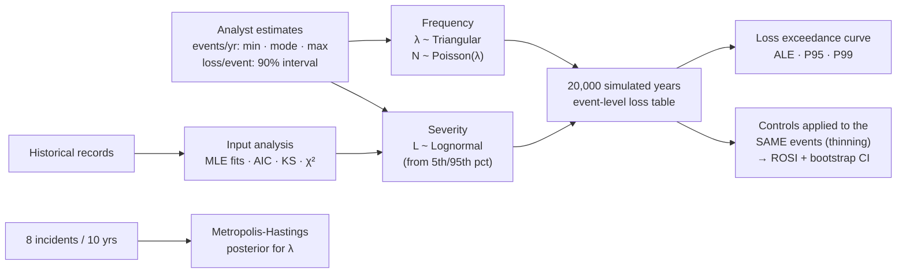

# Cyber Risk Quantification with Monte Carlo Simulation

**FAIR-style annual loss modeling in R: turn analyst estimates into a loss exceedance curve, price security controls by return on investment, and update incident rates with Bayesian MCMC.**


> **Origin:** built on simulation methods from **ISQS 7339 Simulation & Optimization** at Texas Tech University (Spring 2022): input distributions, distribution fitting, Monte Carlo risk analysis, bootstrapping and Metropolis-Hastings. The coursework applied them to travel times, a drug launch and a newsvendor; this repository applies them to cyber risk.

---

## TL;DR

The question a CISO gets from the board: *"How much could we lose to cyber incidents next year, and is this control worth buying?"*

| Output | Result (illustrative inputs, 20,000 simulated years) |
|---|---|
| **Annualized loss expectancy** (5 scenarios) | **$1.20M** mean, $0.68M median: the mean is pulled up by rare, large events |
| **1-in-20-year loss** (P95) | **$4.03M** · 1-in-100-year: $7.58M |
| **P(annual loss > $5M)** | **3.0%** |
| **Best control by ROSI** | Phishing-resistant MFA + payment call-back: **+184%**, pays back in 56% of years |
| **Ransomware control** | EDR + immutable backups: **+69%** ROSI, yet pays back in only 17% of years, because its value is the rare bad year |
| **Bayesian rate check** | Corrected Metropolis-Hastings matches the exact posterior mean (0.899); the original coursework sampler was biased (0.934) |


> **Data note:** the scenario and control inputs in [`data/assumptions/`](data/assumptions/) are **illustrative assumptions for a hypothetical mid-size company**, not benchmarks. The "historical" records used for input analysis are synthetic. The method is the deliverable.

---

## Approach



| Step | Script | Technique |
|---|---|---|
| 1. Input analysis | [`01_input_analysis.R`](scripts/01_input_analysis.R) | Fit Poisson vs. negative binomial to monthly counts (AIC, χ² goodness of fit, dispersion); fit lognormal, gamma, Weibull and exponential to past losses (MLE, AIC, Kolmogorov-Smirnov, Q-Q plot) |
| 2. Annual loss | [`02_simulate_annual_loss.R`](scripts/02_simulate_annual_loss.R) | Compound Poisson-lognormal per scenario with uncertain frequency; loss exceedance curve; ALE, P90/P95/P99 |
| 3. Control ROI | [`03_control_roi.R`](scripts/03_control_roi.R) | Controls thin the same simulated events (common random numbers), uncertain frequency/severity reductions, ROSI, bootstrap CI for loss avoided |
| 4. Bayesian rate | [`04_bayesian_frequency.R`](scripts/04_bayesian_frequency.R) | Random-walk Metropolis-Hastings on log λ, burn-in, acceptance rate, effective sample size, validated against the exact Gamma posterior |

Full tables and all figures: [`docs/results.md`](docs/results.md).

## Results

### Annual loss by scenario

| Scenario | ALE (mean) | Median | P95 (1-in-20) | P(any loss in a year) |
|---|---|---|---|---|
| Ransomware | $337,719 | $0 | $2,145,982 | 18% |
| Business email compromise | $239,333 | $136,541 | $827,258 | 83% |
| Customer data breach | $380,614 | $0 | $1,998,946 | 33% |
| DDoS outage | $132,075 | $90,482 | $401,017 | 90% |
| Insider misuse | $114,455 | $0 | $592,273 | 36% |
| **Total** | **$1,204,196** | **$679,007** | **$4,025,397** | 99% |

Ransomware has a median of $0 yet the highest 1-in-20 loss. Ranking risks by "how often" or by the average alone would hide that.

### Control return on security investment

| Control | Annual cost | Loss avoided / yr (95% CI) | ROSI | Years it pays back |
|---|---|---|---|---|
| EDR + immutable backups | $150,000 | $253,103 ($240,843 – $264,577) | +69% | 17% |
| Phishing-resistant MFA + payment call-back | $60,000 | $170,642 ($167,063 – $174,294) | +184% | 56% |
| DLP + database encryption | $120,000 | $204,529 ($195,941 – $212,447) | +70% | 27% |

**Why thinning?** Each control is applied to the *same* simulated events: an event is prevented with probability *r<sub>f</sub>*, which gives exactly a Poisson process at rate λ(1 − *r<sub>f</sub>*). Comparing "with" and "without" on identical draws removes most of the simulation noise from the difference, which is why the confidence intervals are tight.

### Validating the MCMC sampler

| Method | Posterior mean | 95% interval |
|---|---|---|
| Exact Gamma(9, 10.01) | 0.899 | 0.411 – 1.575 |
| **Corrected** Metropolis-Hastings | 0.899 | 0.407 – 1.602 |
| Original coursework version | 0.934 | 0.390 – 1.678 |

The coursework sampler had two bugs: it stored only *accepted* proposals, which biases the chain toward the regions it moves into, and it used a zero-truncated normal proposal (asymmetric) without the Hastings correction. The fix is a symmetric random walk on log λ with the Jacobian term, recording every iteration. Both versions are in script 04 so the difference can be reproduced.

## Getting started

### Requirements

- R 4.1 or later (tested on 4.6.1) with `ggplot2`, `scales` and `patchwork` (`MASS` ships with R).
- No external data: the inputs are in `data/assumptions/`.

### Install

Missing packages are installed automatically the first time you run the scripts; an interactive R session (RStudio, VS Code) asks first. The list lives in [`r-packages.txt`](r-packages.txt). To install everything up front instead:

```r
install.packages(c("ggplot2", "scales", "patchwork"))
```

### Run

```bash
Rscript run_all.R
```

To model your own organization, edit `data/assumptions/scenarios.csv` and `controls.csv`, then re-run.

### Output

About 10 seconds. The report goes to `docs/results.md` and the figures to `docs/figures/`; intermediate tables go to `outputs/` (git-ignored).

## Repository structure

```
cyber-risk-monte-carlo/
├── run_all.R                    # runs scripts 01-04, writes docs/results.md
├── r-packages.txt               # R packages (installed automatically if missing)
├── R/
│   ├── check_packages.R         # installs missing packages from r-packages.txt
│   ├── distributions.R          # triangular sampler, lognormal-from-interval
│   └── report.R                 # markdown report + figure helpers
├── scripts/01_…04_*.R
├── data/
│   ├── assumptions/             # scenarios.csv, controls.csv (edit these)
│   └── README.md
└── docs/
    ├── results.md               # generated
    └── figures/                 # generated
```

## Skills demonstrated

`Cyber risk quantification (FAIR concepts: loss event frequency, loss magnitude, ALE, loss exceedance)` · `Monte Carlo simulation` · `distribution fitting and goodness-of-fit testing` · `variance reduction with common random numbers` · `bootstrap confidence intervals` · `Bayesian inference with MCMC and sampler validation` · `communicating risk in financial terms`

## Roadmap

- Replace the illustrative inputs with estimates calibrated against public sources (e.g., industry breach-cost and incident-frequency reports) and cite them.
- Add a log-scale tail view of the loss exceedance curve and a risk-tolerance curve for comparison.
- Model correlated scenarios (e.g., a breach that follows a ransomware event) with a copula.
- Feed the MCMC posterior for λ straight into the frequency step instead of the triangular estimate.
- Shiny front end so a non-technical user can edit assumptions and see the curve update.

## Data & citations

- Freund, J. & Jones, J. (2014). *Measuring and Managing Information Risk: A FAIR Approach.* Butterworth-Heinemann.
- Hubbard, D. & Seiersen, R. (2016). *How to Measure Anything in Cybersecurity Risk.* Wiley.

## Author

Javier Casildo

## License

MIT. See [LICENSE](LICENSE).
