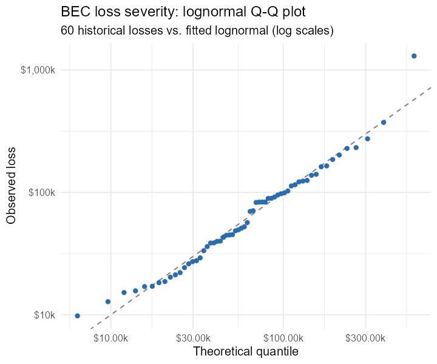
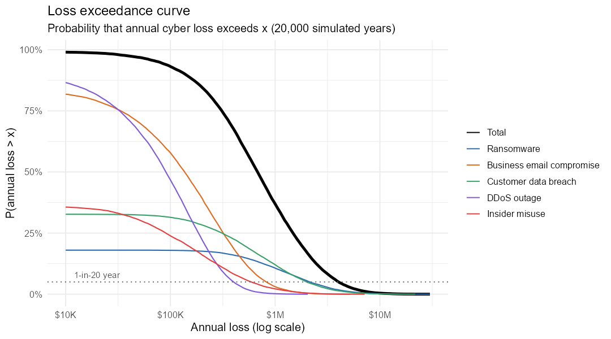
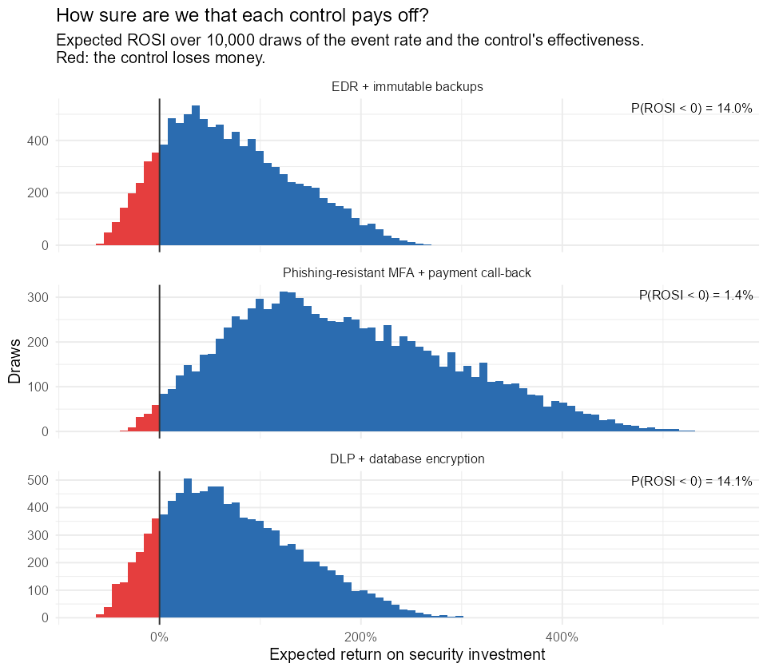
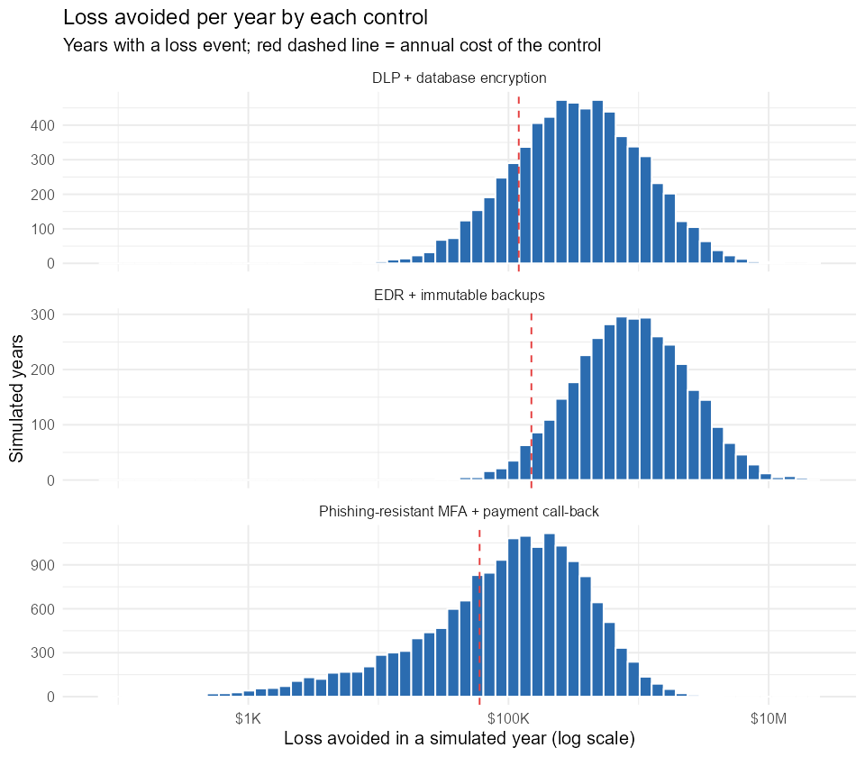
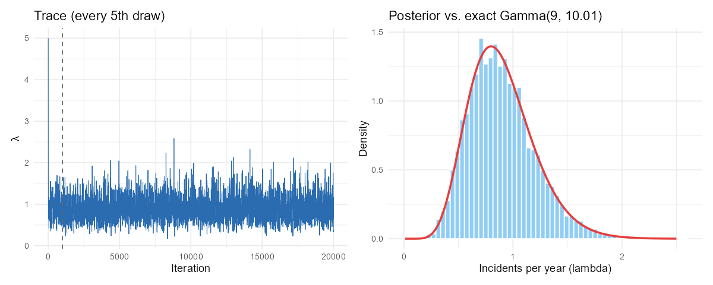
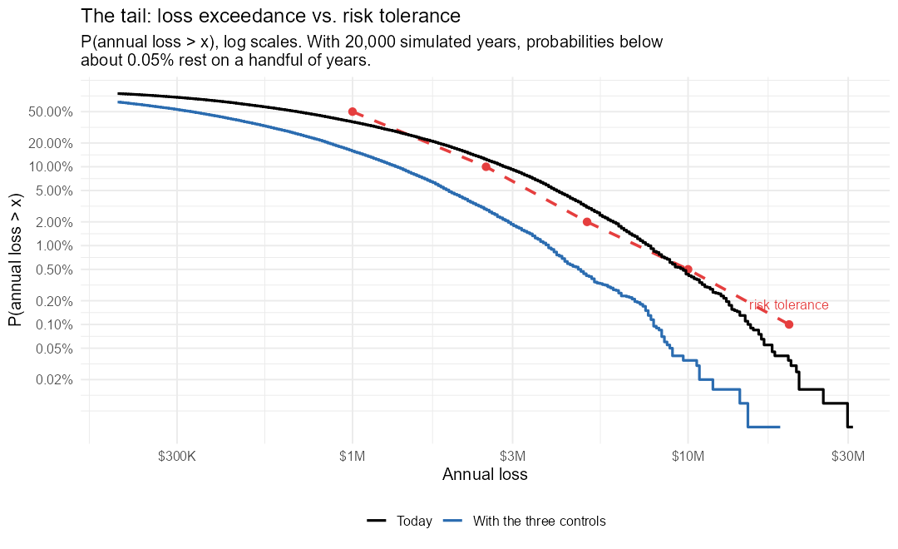
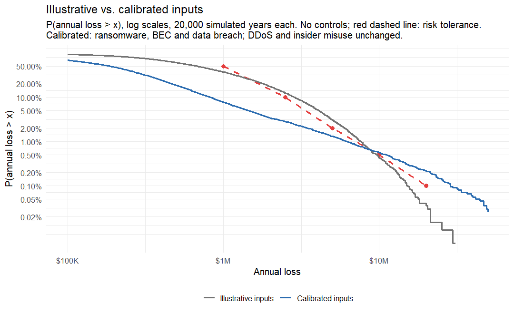

# Results

Generated by `Rscript run_all.R`. Inputs are **illustrative assumptions for a
hypothetical mid-size company** (`data/assumptions/*.csv`), not benchmarks.

## 1. Input analysis

**Frequency (48 months of incident counts).** Variance/mean = 1.16 (a Poisson process gives about 1). AIC prefers the Poisson model, and the chi-square test rejects neither: with only 48 months of data the extra negative-binomial parameter isn't justified yet. Re-test as history accumulates. The synthetic history was in fact drawn from a negative binomial (true variance/mean = 1.48), so this is a miss, not a confirmation: 48 months of counts can't reveal moderate overdispersion, and a Poisson model built on them would understate how clustered incidents are.

| model | AIC | chisq_p_value |
|---|---|---|
| Poisson | 150.8 | 0.168 |
| Negative binomial | 152.2 | 0.181 |

**Severity (60 past BEC losses).** Ranked by AIC:

| distribution | AIC | KS_statistic |
|---|---|---|
| lognormal | 659.2 | 0.080 |
| exponential | 677.1 | 0.110 |
| weibull | 678.6 | 0.124 |
| gamma | 679.1 | 0.109 |

The fitted lognormal implies a 90% interval of $12,939 to $283,941 per event, against the analyst's calibrated $10,000 to $400,000.

## 2. Annual loss distribution

| Scenario | Mean (ALE) | Median | P90 | P95 (1-in-20) | P99 (1-in-100) | P(any loss) |
|---|---|---|---|---|---|---|
| Ransomware | $337,719 | $0 | $1,094,457 | $2,145,982 | $5,254,388 | 18% |
| Business email compromise | $239,333 | $136,541 | $589,297 | $827,258 | $1,523,803 | 83% |
| Customer data breach | $380,614 | $0 | $1,185,551 | $1,998,946 | $4,659,665 | 33% |
| DDoS outage | $132,075 | $90,482 | $304,797 | $401,017 | $644,679 | 90% |
| Insider misuse | $114,455 | $0 | $341,942 | $592,273 | $1,497,092 | 36% |
| Total | $1,204,196 | $679,007 | $2,822,029 | $4,025,397 | $7,576,187 | 99% |

Probability that total annual loss exceeds a threshold:

| threshold | probability |
|---|---|
| $1,000,000 | 36.9% |
| $5,000,000 | 3.0% |
| $10,000,000 | 0.4% |

The mean (annualized loss expectancy) sits far above the median: in most years losses are modest, and rare ransomware or data-breach years drive the tail.

**Monte Carlo error.** The table above is exact for this seed, not to the dollar. Bootstrap standard errors over the 20,000 simulated years (200 resamples) show how far another seed could move each figure. They measure simulation noise only, not uncertainty in the assumptions:

| Scenario | Mean (ALE) | P95 (1-in-20) | P99 (1-in-100) |
|---|---|---|---|
| Ransomware | $338k ± $8.0k | $2.15M ± $45k | $5.25M ± $170k |
| Business email compromise | $239k ± $2.4k | $827k ± $12k | $1.52M ± $40k |
| Customer data breach | $381k ± $7.3k | $2.00M ± $37k | $4.66M ± $150k |
| DDoS outage | $132k ± $1.0k | $401k ± $4.1k | $645k ± $15k |
| Insider misuse | $114k ± $2.2k | $592k ± $13k | $1.50M ± $44k |
| Total | $1.20M ± $11k | $4.03M ± $60k | $7.58M ± $160k |

### Sensitivity to modeling choices

Same seed, one choice changed at a time. Beta-PERT uses the same min / mode / max as the triangular but puts less weight near the extremes, so it lowers the mean event rate whenever the mode sits closer to the minimum, as it does for every scenario here. The cap applies to each single loss, so it cannot move a percentile of annual loss that is already below the cap.

| Model | Total ALE | P95 (1-in-20) | P99 (1-in-100) | P(> $5M) | Largest single event |
|---|---|---|---|---|---|
| Base: triangular frequency, uncapped | $1.20M | $4.03M | $7.58M | 3.0% | $31.2M |
| Beta-PERT frequency | $1.05M | $3.72M | $7.23M | 2.6% | $26.4M |
| Single loss capped at $10M | $1.19M | $4.03M | $7.58M | 3.0% | $10.0M |
| Beta-PERT and capped | $1.04M | $3.72M | $7.23M | 2.6% | $10.0M |
| Double extortion: 30% of ransomware events also leak data | $1.20M | $4.18M | $7.79M | 3.4% | $31.2M |

**Dependence.** The base model treats the scenarios as independent. In the double-extortion run, each ransomware event also causes a customer data breach with probability 0.3, and the standalone breach rate is lowered by the same expected number of events. Breach frequency is unchanged on average (breach ALE $381k in the base run, $376k here), so only the dependence changes: large breach losses now arrive in ransomware years. The 1-in-100-year loss moves from $7.58M to $7.79M.

## 3. Control ROI

| Control | Scenario | Annual cost | Loss avoided / yr (90% uncertainty band) | ROSI (90% band) | P(ROSI < 0) | Years it pays back |
|---|---|---|---|---|---|---|
| EDR + immutable backups | Ransomware | $150,000 | $253k ($115k – $429k) | +69% (-23% to +186%) | 14.0% | 17% |
| Phishing-resistant MFA + payment call-back | Business email compromise | $60,000 | $171k ($75.8k – $289k) | +184% (+26% to +382%) | 1.4% | 56% |
| DLP + database encryption | Customer data breach | $120,000 | $205k ($91.0k – $356k) | +70% (-24% to +197%) | 14.1% | 27% |

**Two kinds of uncertainty.** The expected ROSI averages over everything, including what we don't know. The 90% band and P(ROSI < 0) come from a two-level analysis: the long-run event rate and the control's effectiveness are drawn once and held fixed (10,000 draws), and the expected loss avoided is computed for each draw. P(ROSI < 0) is the chance that, given what we don't know, the control costs more than it saves on average. Loss sizes are treated as known here; the next table widens them.

*Years it pays back* is the share of simulated years in which the loss avoided that year exceeds the control's cost. A control can have a strongly positive expected ROSI and still "lose money" in most individual years, because its value comes from the rare bad year. For EDR it is close to the share of years with any ransomware event.

**Is it worth learning more before buying?** The expected value of perfect information (EVPI) is the most it would be worth paying, per year, to know the true event rate and effectiveness before deciding: the money lost on average in the draws where buying turns out to be the wrong call. The largest here is $4.0k for EDR + immutable backups, 3% of its annual cost. The *wider losses* columns widen every scenario's 90% loss interval by a factor of 1.5 in the outer draws (a lognormal multiplier with mean 1 and 90% of draws between 1/1.5 and 1.5; the `loss_uncertainty` column in `scenarios.csv` sets it per scenario). Expected ROSI does not change; only the spread grows.

| Control | P(ROSI < 0) | EVPI / yr | P(ROSI < 0), wider losses | ROSI 90% band, wider losses | EVPI / yr, wider losses |
|---|---|---|---|---|---|
| EDR + immutable backups | 14.0% | $4.0k | 18.6% | -31% to +218% | $6.2k |
| Phishing-resistant MFA + payment call-back | 1.4% | $98 | 3.3% | +11% to +429% | $320 |
| DLP + database encryption | 14.1% | $3.4k | 18.3% | -34% to +223% | $5.2k |

**Monte Carlo detail.** The interval below is a bootstrap over simulated years: how far another seed would move the mean, not uncertainty about the control. The last column holds the event rate at its expected value, so the remaining risk of losing money comes from the control's effectiveness alone.

| Control | ALE before | ALE after | Loss avoided / yr (Monte Carlo 95% CI) | P(ROSI < 0) if the event rate were known |
|---|---|---|---|---|
| EDR + immutable backups | $337,719 | $84,615 | $253,103 ($240,843 – $264,577) | 0.0% |
| Phishing-resistant MFA + payment call-back | $239,333 | $68,691 | $170,642 ($167,063 – $174,294) | 0.0% |
| DLP + database encryption | $380,614 | $176,085 | $204,529 ($195,941 – $212,447) | 0.0% |

With the event rate known, no control loses money even at the bottom of its effectiveness range. The risk of a negative return comes from not knowing how often the scenario happens, so a better frequency estimate (see section 4) is worth more here than a better effectiveness estimate.

## 4. Bayesian incident rate (Metropolis-Hastings)

8 insider-misuse incidents in 10 years with a near-flat prior gives an exact Gamma(9, 10.01) posterior, which makes a good test for the sampler.

| method | mean | q025 | median | q975 | draws_kept |
|---|---|---|---|---|---|
| Exact Gamma(9, 10.01) | 0.899 | 0.411 | 0.866 | 1.575 | – |
| Corrected MH (log random walk) | 0.899 | 0.407 | 0.864 | 1.602 | 19,000 |
| Original 2022 MH | 0.934 | 0.390 | 0.906 | 1.678 | 6,785 |

Corrected sampler: acceptance rate 54%, effective sample size ≈ 4,133 of 19,000 post-burn-in draws. The original version keeps only accepted proposals and uses an uncorrected asymmetric proposal; compare its row with the exact answer.

**Convergence.** Split R-hat over four chains (started at 0.05, 0.5, 2 and 5) is 1.000, and the Monte Carlo standard error of the posterior mean is 0.0048. The gap to the exact mean, +0.0002, is within two standard errors.

**Which bug does what.** Each variant run as 10 chains of 20,000 iterations, first 1,000 dropped; exact posterior mean 0.899.

| Sampler | Posterior mean | Chain-to-chain sd | Bias vs. exact |
|---|---|---|---|
| Corrected: log random walk, every iteration | 0.902 | 0.003 | +0.003 |
| Bug 1 only: log random walk, accepted proposals only | 0.893 | 0.002 | -0.006 |
| Bug 2 only: truncated proposal, no Hastings correction, every iteration | 0.928 | 0.005 | +0.029 |
| Truncated proposal with Hastings correction, every iteration | 0.900 | 0.005 | +0.000 |
| Both bugs (original 2022 sampler) | 0.931 | 0.005 | +0.032 |

**Feeding the posterior into the simulation.** Script 02 draws the insider misuse rate from the analyst's min / mode / max. Here the rate is drawn from the posterior instead and the years are simulated again with the same seed. The data say incidents are 1.9 times as frequent as the analyst thought. The headline results keep the expert estimate, because the 8 incidents are part of an illustrative story; with real incident logs, this is the step that replaces a guess with evidence.

| Frequency | Mean events / yr | Insider misuse ALE | Insider misuse P95 | Total ALE | Total P95 | Total P99 |
|---|---|---|---|---|---|---|
| Expert estimate: triangular(0.1, 0.3, 1) | 0.467 | $114k | $592k | $1.20M | $4.03M | $7.58M |
| MCMC posterior: 8 incidents in 10 years | 0.899 | $219k | $945k | $1.31M | $4.20M | $7.64M |

## 5. Risk tolerance

An illustrative risk appetite (`data/assumptions/tolerance.csv`), checked against the simulated total annual loss. ± is one binomial standard error in percentage points.

| Annual loss over | Tolerated probability | Today | With the proposed controls |
|---|---|---|---|
| $1.0M | 50.0% | 36.88% ± 0.34 within | 15.74% ± 0.26 within |
| $2.5M | 10.0% | 12.22% ± 0.23 **exceeds** | 2.85% ± 0.12 within |
| $5.0M | 2.0% | 3.04% ± 0.12 **exceeds** | 0.40% ± 0.04 within |
| $10M | 0.5% | 0.41% ± 0.05 within | 0.03% ± 0.01 within |
| $20M | 0.1% | 0.03% ± 0.01 within | 0.00% ± 0.00 within |

Between the stated points the tolerance is interpolated on log-log scales. On that curve, today's loss exceedance curve is above the tolerance curve for annual losses between about $1.5M and $8.7M. With the proposed controls it stays inside the tolerance curve everywhere it is defined.

## 6. Calibrated inputs

The same model, controls and tolerance with `scenarios_calibrated.csv`: frequencies and loss ranges sized for a mid-size US critical-infrastructure operator (about $500M revenue) from public sources, with the derivation in [calibration.md](calibration.md). Three scenarios are calibrated; DDoS outage and insider misuse keep their illustrative values because no usable public figures exist at this size. 20,000 simulated years, same seed as section 2.

| Scenario | Confidence | ALE, illustrative | ALE, calibrated | P95, illustrative | P95, calibrated |
|---|---|---|---|---|---|
| Ransomware | medium | $338k | $175k | $2.15M | $0 |
| Business email compromise | low | $239k | $24.4k | $827k | $139k |
| Customer data breach | low | $381k | $56.2k | $2.00M | $0 |
| DDoS outage | not calibrated | $132k | $132k | $401k | $402k |
| Insider misuse | not calibrated | $114k | $114k | $592k | $579k |
| Total |  | $1.20M | $503k | $4.03M | $1.42M |

| Inputs | Total ALE | P95 (1-in-20) | P99 (1-in-100) | P(> $5M) |
|---|---|---|---|---|
| Illustrative | $1.20M | $4.03M | $7.58M | 3.0% |
| Calibrated | $503k | $1.42M | $6.11M | 1.3% |

**Risk tolerance with calibrated inputs.** ± is one binomial standard error in percentage points; an exceedance within about one standard error of the tolerance is not a clear breach.

| Annual loss over | Tolerated | Illustrative | Calibrated | Calibrated, with the proposed controls |
|---|---|---|---|---|
| $1.0M | 50.0% | 36.88% ± 0.34 within | 7.65% ± 0.19 within | 4.93% ± 0.15 within |
| $2.5M | 10.0% | 12.22% ± 0.23 **exceeds** | 2.80% ± 0.12 within | 1.14% ± 0.08 within |
| $5.0M | 2.0% | 3.04% ± 0.12 **exceeds** | 1.30% ± 0.08 within | 0.32% ± 0.04 within |
| $10M | 0.5% | 0.41% ± 0.05 within | 0.54% ± 0.05 **exceeds** | 0.10% ± 0.02 within |
| $20M | 0.1% | 0.03% ± 0.01 within | 0.21% ± 0.03 **exceeds** | 0.03% ± 0.01 within |

**Controls with calibrated inputs.** Same costs and effectiveness ranges as section 3 (those are still illustrative). Loss avoided is the closed-form expectation; P(ROSI < 0) and EVPI come from 10,000 two-level draws.

| Control | Annual cost | Loss avoided / yr | Expected ROSI | P(ROSI < 0) | EVPI / yr |
|---|---|---|---|---|---|
| EDR + immutable backups | $150,000 | $149k | -1% | 56.0% | $33k |
| Phishing-resistant MFA + payment call-back | $60,000 | $16.1k | -73% | 100.0% | $0 |
| DLP + database encryption | $120,000 | $32.6k | -73% | 100.0% | $0 |

